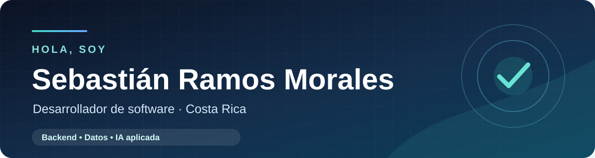

**Desarrollador de software junior · C#/.NET · Python · SQL**

Me gusta construir aplicaciones útiles y conectar el backend con los datos para resolver problemas reales.

---

## 👨‍💻 Sobre mí

Soy **Sebastián**, estudiante de Desarrollo de Software en el **Instituto Nacional de Aprendizaje (INA)** de Costa Rica. Disfruto entender un problema de principio a fin: organizar la información, diseñar la lógica de la aplicación y crear una experiencia clara para quien la usa.

He desarrollado aplicaciones de escritorio con **C# y .NET**, trabajado con servicios backend en **Python y Node.js** y utilizado bases de datos relacionales. Me interesan especialmente la arquitectura de aplicaciones, las APIs y la inteligencia artificial aplicada a datos.

## ✨ Experiencia destacada

### Agente Text-to-SQL · Pasantía internacional en Chile

En **2026** participé en una pasantía en la **Universidad Andrés Bello (UNAB)**, vinculada al INA y ChileValora. Colaboré en un proyecto de agentes de inteligencia artificial generativa, con enfoque en **Text-to-SQL**: transformar preguntas en lenguaje natural en consultas SQL y validar esas consultas.

Durante esta experiencia trabajé con **Python, FastAPI, PostgreSQL, Docker y modelos de lenguaje locales**, además de la integración del backend con una interfaz desarrollada en Angular.

## 🛠️ Tecnologías

| Área | Tecnologías y herramientas |
| --- | --- |
| **Lenguajes** | C#, Python, JavaScript, SQL |
| **Backend** | .NET, Node.js, Express.js, FastAPI |
| **Bases de datos** | PostgreSQL, SQL Server, MySQL, Supabase |
| **Interfaces** | HTML, CSS, Windows Forms, WPF, Avalonia UI |
| **Herramientas** | Git, GitHub, Docker |

**Ahora mismo profundizo en:** desarrollo backend, arquitectura de aplicaciones e integración de IA con bases de datos.

## 🎓 Formación

- **Desarrollo de Software**, Instituto Nacional de Aprendizaje (INA) · En curso.
- **Pasantía internacional**, Universidad Andrés Bello (UNAB), Chile · 2026.
- **Inglés B1**, acreditado mediante el Michigan English Test (MET).

## 📫 Contacto

Me interesa colaborar en proyectos de software y seguir creciendo como desarrollador. Puedes escribirme a **[sebas18102006@gmail.com](mailto:sebas18102006@gmail.com)**.

**Gracias por visitar mi perfil.** 🚀

